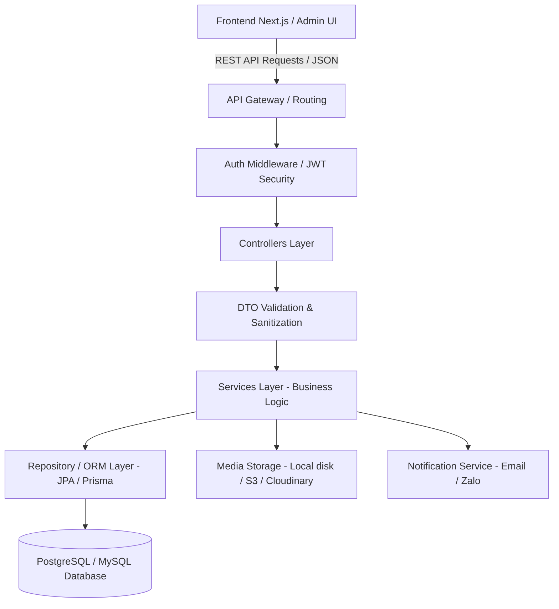
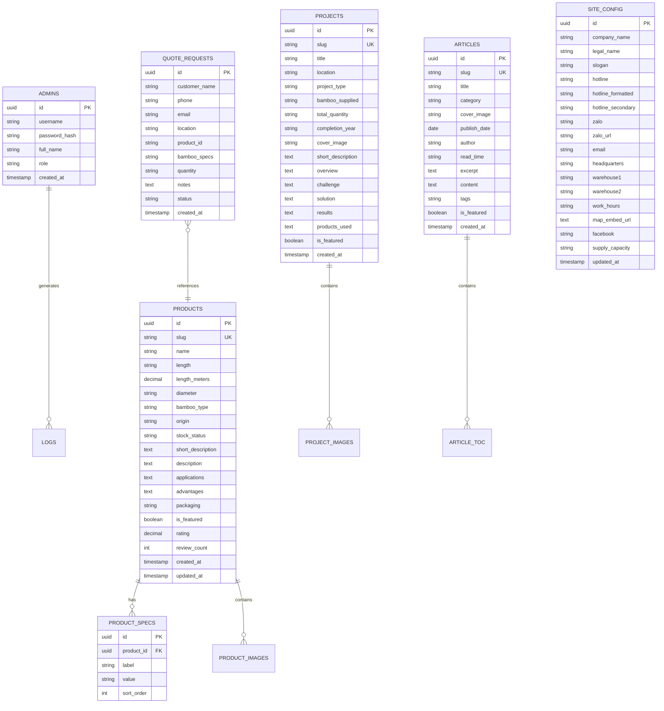
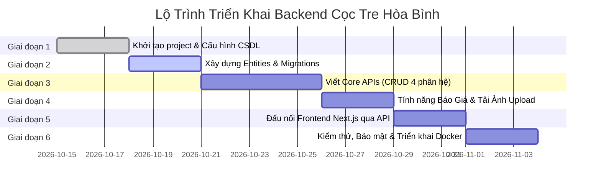

# 📋 KẾ HOẠCH TOÀN DIỆN XÂY DỰNG HỆ THỐNG BACKEND
**Dự Án:** Website Doanh Nghiệp & Quản Trị Cọc Tre Hòa Bình  
**Phiên Bản Kế Hoạch:** 1.0  
**Ngày Lập:** 15/10/2026  

---

## 📌 1. Mục Tiêu & Phạm Vi Dự Án

Hệ thống Backend được xây dựng nhằm chuyển đổi từ giải pháp lưu trữ tạm thời cục bộ (LocalStorage) sang hệ thống **Backend RESTful API & Cơ sở dữ liệu tập trung**, phục vụ:
1. **Lưu trữ & đồng bộ dữ liệu:** Quản lý tập trung Sản phẩm, Bài viết, Dự án, Cấu hình doanh nghiệp.
2. **Tiếp nhận & xử lý Yêu cầu Báo Giá:** Tiếp nhận thông tin khách hàng gửi form báo giá từ website, lưu trữ lịch sử, gửi thông báo qua Email/Telegram/Zalo OA cho nhân viên kinh doanh.
3. **Phân quyền & Bảo mật Quản Trị:** Quản lý phiên đăng nhập Admin an toàn qua JWT Token/Session thay vì chỉ kiểm tra mã PIN client-side.
4. **Quản lý File & Media:** Lưu trữ và nén ảnh sản phẩm, ảnh chụp công trình, ảnh bài viết tải lên từ trang Admin.
5. **Khả năng mở rộng:** Dễ dàng tích hợp ứng dụng di động hoặc mở rộng tính năng quản lý xuất/nhập tồn kho cọc tre sau này.

---

## 🛠️ 2. Lựa Chọn & So Sánh Công Nghệ (Tech Stack)

Dựa trên định hướng trước đó (cân nhắc giữa **Java** và **Node.js/TypeScript**):

| Tiêu Chí | Lựa Chọn A: Java (Spring Boot 3) | Lựa Chọn B: Node.js (NestJS / Express) |
| :--- | :--- | :--- |
| **Công Nghệ** | Java 17/21 + Spring Boot 3 + Spring Data JPA | Node.js + TypeScript + NestJS (hoặc Express) + Prisma ORM |
| **Cơ Sở Dữ Liệu** | PostgreSQL / MySQL | PostgreSQL / MySQL / SQLite |
| **Ưu Điểm** | - Kiến trúc doanh nghiệp chuẩn mực, cực kỳ ổn định, bảo mật cao.<br>- Phù hợp nếu bạn muốn phát triển kỹ năng backend chuyên sâu với hệ sinh thái Java.<br>- Xử lý đa luồng mạnh mẽ. | - Cùng dùng chung ngôn ngữ **TypeScript** với Frontend Next.js, tái sử dụng được Type/Interface.<br>- Cú pháp hiện đại, khởi tạo và triển khai nhanh chóng.<br>- Nhẹ tài nguyên máy chủ. |
| **Nhược Điểm** | Khởi động nặng hơn, cú pháp tường minh và cấu hình ban đầu nhiều hơn. | Đòi hỏi quản lý kiến trúc chặt chẽ để không bị lộn xộn mã nguồn (nếu dùng Express). |
| **Độ Phù Hợp** | Rất tốt nếu định hướng dài hạn là hệ sinh thái Java / Spring. | Rất nhanh gọn cho dự án vừa & nhỏ, dễ đồng bộ code frontend. |

> [!TIP]
> **Khuyến Nghị Triển Khai:**
> - Nếu bạn muốn chuyên sâu **Java**: Chọn **Spring Boot 3 + Spring Data JPA + PostgreSQL**.
> - Nếu bạn muốn hoàn thành nhanh, dễ bảo trì cùng Frontend: Chọn **NestJS (TypeScript) + Prisma + PostgreSQL**.

---

## 🏗️ 3. Kiến Trúc Hệ Thống (System Architecture)

Hệ thống Backend tuân theo mô hình **Phân lớp chuẩn mực (Layered Architecture)**:



### Cấu Trúc Thư Mục Dự Kiến (`backend/`):
```text
backend/
├── src/
│   ├── config/             # Cấu hình CSDL, JWT, Mail, CORS, biến môi trường
│   ├── controllers/        # Tiếp nhận request HTTP, gọi service, trả response
│   ├── services/           # Nghiệp vụ: tính toán, xử lý logic, transaction
│   ├── repositories/       # Truy vấn dữ liệu từ CSDL (JPA Repository / Prisma)
│   ├── models/ (hoặc entities/) # Định nghĩa bảng dữ liệu (Entities)
│   ├── dtos/               # Data Transfer Objects & Schema Validation
│   ├── middlewares/        # Xác thực Token, bắt lỗi Exception Handler, Rate Limit
│   ├── utils/              # Tiện ích: slugify, mã hóa mật khẩu, upload file
│   └── main.ts / Application.java # Điểm khởi động ứng dụng
├── uploads/                # Thư mục lưu trữ hình ảnh tải lên
├── Dockerfile              # Container đóng gói ứng dụng
└── README.md
```

---

## 🗄️ 4. Thiết Kế Cơ Sở Dữ Liệu (Database Schema / ERD)



---

## 🔌 5. Đặc Tả Chi Tiết Hệ Thống RESTful API

Quy ước chung:
- URL tiền tố: `/api/v1`
- Định dạng dữ liệu: `application/json`
- Chuẩn phản hồi:
  ```json
  {
    "success": true,
    "message": "Thông báo kết quả",
    "data": { ... },
    "pagination": { "page": 1, "pageSize": 10, "total": 45 }
  }
  ```

### 5.1. Xác thực & Quản trị (`/api/v1/auth`)
- `POST /api/v1/auth/login`: Đăng nhập admin (nhận PIN hoặc username/password, trả về JWT Token).
- `POST /api/v1/auth/logout`: Hủy token/phiên làm việc.
- `GET /api/v1/auth/me`: Kiểm tra thông tin người dùng hiện tại từ Token.

### 5.2. Quản lý Sản phẩm (`/api/v1/products`)
- `GET /api/v1/products`: Lấy danh sách sản phẩm (hỗ trợ lọc theo `length`, tìm kiếm `search`, sắp xếp).
- `GET /api/v1/products/:slugOrId`: Lấy chi tiết 1 sản phẩm kèm thông số và các sản phẩm liên quan.
- `POST /api/v1/products` *(Admin)*: Tạo mới sản phẩm cọc tre.
- `PUT /api/v1/products/:id` *(Admin)*: Cập nhật thông tin, quy cách, ảnh sản phẩm.
- `DELETE /api/v1/products/:id` *(Admin)*: Xóa sản phẩm.
- `POST /api/v1/products/reset` *(Admin)*: Khôi phục danh sách sản phẩm mẫu ban đầu.

### 5.3. Quản lý Dự án (`/api/v1/projects`)
- `GET /api/v1/projects`: Lấy danh sách công trình dự án (lọc theo loại hình: giao thông, đê kè, công nghiệp).
- `GET /api/v1/projects/:slugOrId`: Chi tiết dự án, thách thức, giải pháp, vật tư đã cấp.
- `POST /api/v1/projects` *(Admin)*: Thêm dự án mới.
- `PUT /api/v1/projects/:id` *(Admin)*: Cập nhật nội dung dự án.
- `DELETE /api/v1/projects/:id` *(Admin)*: Xóa dự án.

### 5.4. Quản lý Tin tức & Cẩm nang (`/api/v1/articles`)
- `GET /api/v1/articles`: Danh sách bài viết (phân trang, lọc theo chuyên mục, tìm kiếm).
- `GET /api/v1/articles/:slugOrId`: Chi tiết bài viết Markdown kèm mục lục.
- `POST /api/v1/articles` *(Admin)*: Xuất bản bài viết mới.
- `PUT /api/v1/articles/:id` *(Admin)*: Cập nhật nội dung bài viết.
- `DELETE /api/v1/articles/:id` *(Admin)*: Xóa bài viết.

### 5.5. Quản lý Thông tin liên hệ & Cấu hình (`/api/v1/config`)
- `GET /api/v1/config`: Lấy thông tin hotline, zalo, địa chỉ kho bãi.
- `PUT /api/v1/config` *(Admin)*: Cập nhật thông tin hotline, địa chỉ kho, email, fanpage.

### 5.6. Tiếp nhận Báo giá (`/api/v1/quotes`)
- `POST /api/v1/quotes`: Khách hàng gửi yêu cầu báo giá từ popup/form trên web.
- `GET /api/v1/quotes` *(Admin)*: Quản lý danh sách khách hàng cần liên hệ báo giá.
- `PATCH /api/v1/quotes/:id/status` *(Admin)*: Đổi trạng thái (`Mới`, `Đã liên hệ`, `Đã chốt hợp đồng`, `Hủy`).

### 5.7. Tải lên hình ảnh Media (`/api/v1/upload`)
- `POST /api/v1/upload` *(Admin)*: Tải ảnh từ máy lên (WebP, JPG, PNG), tự động nén tối ưu và trả về đường dẫn URL ảnh.

---

## 📅 6. Lộ Trình Triển Khai Theo Từng Giai Đoạn



### Chi tiết các bước thực hiện:

#### Giai đoạn 1: Thiết lập nền móng dự án
- Tạo thư mục `backend/` ngang cấp với `frontend/`.
- Cài đặt khung framework (Java Spring Boot 3 hoặc NestJS/Express).
- Cấu hình file biến môi trường `.env` (`PORT`, `DATABASE_URL`, `JWT_SECRET`, `CORS_ORIGIN`).
- Khởi động cơ sở dữ liệu PostgreSQL cục bộ hoặc qua Docker Compose.

#### Giai đoạn 2: Lập trình CSDL & Entities
- Thiết lập Migration tạo các bảng: `products`, `articles`, `projects`, `site_config`, `quote_requests`, `admins`.
- Viết sẵn dữ liệu khởi tạo (Seed data) lấy từ các file dữ liệu chuẩn hiện có (`src/data/*.ts`) để khi backend chạy lên đã có sẵn toàn bộ dữ liệu cọc tre ban đầu.

#### Giai đoạn 3: Hiện thực hóa các API nghiệp vụ
- Xây dựng Module Authentication: Xác thực JWT, bảo vệ các endpoint POST/PUT/DELETE.
- Xây dựng 4 Controller & Service cho: Sản phẩm, Tin tức, Dự án, Cấu hình liên hệ.
- Thiết lập bắt lỗi toàn cục (Global Exception Handler) và kiểm tra dữ liệu đầu vào (Validation Pipes / DTO).

#### Giai đoạn 4: Quản lý File Upload & Tiếp nhận Khách
- Viết API upload ảnh hỗ trợ lưu file vào thư mục tĩnh hoặc dịch vụ lưu trữ đám mây.
- Viết Module tiếp nhận yêu cầu báo giá: Tự động lưu thông tin khách hàng, tích hợp gửi email thông báo khi có đơn mới.

#### Giai đoạn 5: Đấu nối Frontend Next.js với Backend API
- Cập nhật file [frontend/src/lib/api.ts](file:///Users/xbaek/Coctre/frontend/src/lib/api.ts):
  + Khi bật biến môi trường `NEXT_PUBLIC_API_URL=http://localhost:5000/api/v1`, frontend sẽ tự động gọi API thay vì đọc/ghi vào LocalStorage.
  + Đảm bảo chuyển đổi mượt mà 100%: nếu chưa bật backend, website vẫn chạy bình thường với LocalStorage.

#### Giai đoạn 6: Kiểm thử, Tối ưu hóa & Triển khai
- Kiểm thử toàn diện tất cả các trường hợp biên (Corner cases), API response status codes.
- Cấu hình CORS chặt chẽ, Helmet bảo mật tiêu đề HTTP, Rate Limiting chống spam form báo giá.
- Tạo file `docker-compose.yml` để chạy đồng thời cả Frontend, Backend và Database chỉ với 1 lệnh `docker compose up`.

---

## 💡 7. Đề Xuất Bước Kế Tiếp

Bạn muốn bắt đầu triển khai Backend theo lựa chọn công nghệ nào?
1. **Lựa chọn 1 (Khuyên dùng nếu muốn hệ sinh thái Java):** Xây dựng **Java Spring Boot 3 + Maven + Spring Data JPA + PostgreSQL**.
2. **Lựa chọn 2 (Khuyên dùng nếu muốn phát triển nhanh, đồng bộ TypeScript):** Xây dựng **Node.js + NestJS (hoặc Express) + Prisma ORM + PostgreSQL**.

Khi bạn đã sẵn sàng, chúng ta có thể bắt đầu ngay từ **Giai đoạn 1: Khởi tạo cấu trúc dự án `backend/`**!
